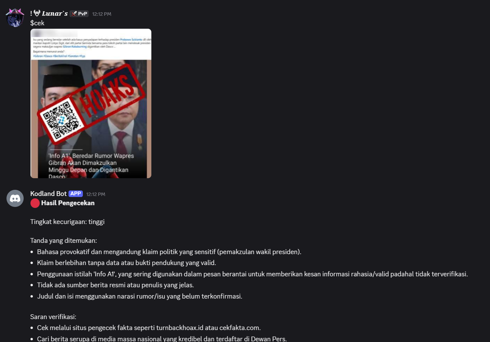

# 🛡️ Bot Discord Pemeriksa Hoaks


Bot Discord yang membantu mengecek apakah sebuah pesan atau berita punya ciri-ciri hoaks. Kirim teks atau screenshot-nya, lalu bot menjelaskan bagian yang mencurigakan dan cara memverifikasinya. Ini proyek final saya di Kodland.

> Hasil bot hanya perkiraan, bukan pengecekan fakta. Tetap verifikasi ke sumber resmi seperti [turnbackhoax.id](https://turnbackhoax.id).

## Daftar isi

- [Deskripsi](#deskripsi)
- [Tangkapan layar](#tangkapan-layar)
- [Fitur](#fitur)
- [Perintah](#perintah)
- [Cara kerja](#cara-kerja)
- [Cara menjalankan](#cara-menjalankan)
- [Pengaturan](#pengaturan)
- [Kalau ada masalah](#kalau-ada-masalah)
- [Keterbatasan](#keterbatasan)
- [Data yang disimpan](#data-yang-disimpan)
- [Isi repo](#isi-repo)
- [Yang saya pelajari](#yang-saya-pelajari)
- [Lisensi](#lisensi)

## Deskripsi

Saya sering melihat pesan berantai dan screenshot berita palsu beredar di grup chat. Biasanya orang langsung menyebarkannya tanpa dicek dulu. Bot ini saya buat supaya pengecekan awal bisa dilakukan langsung di Discord, dalam beberapa detik.

Yang dilakukan bot: menerima teks, screenshot, atau pesan orang lain yang dibalas dengan `$cek`, lalu menjawab dengan tiga hal:

1. **Tingkat kecurigaan**: 🟢 rendah, 🟡 sedang, atau 🔴 tinggi
2. **Tanda yang ditemukan**, misalnya bahasa menakut-nakuti, huruf kapital dan tanda seru berlebihan, tidak ada sumber, klaim tanpa data, atau ajakan menyebarkan
3. **Saran verifikasi**, misalnya cek situs resmi atau turnbackhoax.id

## Tangkapan layar

**Cek teks**


**Cek screenshot**



**Riwayat dan statistik**


<!-- Kalau punya GIF demo, tambahkan di sini:  -->
<!-- Kalau bot sudah online, tambahkan link undangannya di sini -->

## Fitur

- 📝 Cek teks berita atau pesan berantai
- 🖼️ Cek screenshot (model membaca tulisan di gambar)
- 💬 Cek pesan orang lain, cukup balas pesannya dengan `$cek`
- 📜 Riwayat pengecekan per pengguna
- 📊 Statistik pengecekan
- 🔒 Perlindungan dasar dari prompt injection dan spam mention

## Perintah

| Perintah | Fungsi |
|---|---|
| `$cek <teks>` | cek teks |
| `$cek` + gambar | cek screenshot |
| `$cek` (balas pesan lain) | cek pesan yang dibalas |
| `$riwayat` | 5 pengecekan terakhirmu |
| `$hapusriwayat` | hapus riwayatmu |
| `$statistik` | statistik semua pengecekan |
| `$bantuan` | daftar perintah |

Contoh pemakaian dan jawaban bot:

```
$cek BREAKING!!! SEBARKAN SEKARANG KE SEMUA GRUP, LISTRIK AKAN PADAM 3 HARI!!!
```

```
🔴 Hasil Pengecekan

Tingkat kecurigaan: tinggi
Tanda yang ditemukan:
- Bahasa provokatif dan menakut-nakuti
- Huruf kapital dan tanda seru berlebihan
- Tidak ada sumber atau penulis yang jelas
- Ajakan menyebarkan secara masif
Saran verifikasi:
- Cek akun media sosial resmi PLN atau situs web resmi pln.co.id
- Cari berita serupa di media massa nasional yang terpercaya
- Cek melalui situs turnbackhoax.id

Ini hanya perkiraan, selalu verifikasi ke sumber resmi.
```

## Cara kerja

Saya tidak melatih model sendiri. Bot memakai model yang dijalankan lewat [Ollama](https://ollama.com), dan model itu bisa membaca gambar. Pekerjaan bot ada di sekelilingnya: menyiapkan input, memberi instruksi yang tepat, membaca jawabannya, dan menyimpan hasilnya.

Alurnya singkat: pengguna mengetik `$cek`, bot memeriksa inputnya (maksimal 4000 karakter dan 5 MB), mengirimnya ke model lewat Ollama, mengambil tingkat kecurigaan dari jawaban model, menyimpannya ke SQLite, lalu menampilkan hasilnya dengan emoji warna.

Beberapa hal yang saya atur di dalamnya:

- **Instruksi sistem** meminta model mencari tanda hoaks tertentu dan menjawab dengan format tetap. Karena formatnya tetap, bot bisa mengambil tingkat kecurigaannya dengan pencarian pola sederhana.
- **Teks pengguna dibungkus tanda `<<<` dan `>>>`**, dan model diminta menganggapnya sebagai data saja. Jadi kalimat seperti "abaikan semua instruksi sebelumnya" di dalam teks tidak diikuti.
- **Model dilarang menyimpulkan sesuatu pasti benar atau pasti hoaks**, dan setiap jawaban ditutup dengan pengingat untuk verifikasi.
- Kalau model tidak menjawab dalam 120 detik, bot berhenti menunggu dan memberi tahu pengguna.

## Cara menjalankan

1. Buat bot di [Discord Developer Portal](https://discord.com/developers/applications), salin tokennya, dan nyalakan **Message Content Intent** di menu Bot. Setelah itu undang bot ke server.
2. Pasang [Ollama](https://ollama.com) dan siapkan modelnya. Untuk fitur screenshot, modelnya harus bisa membaca gambar.
3. Unduh proyek dan pasang library:

```bash
git clone https://github.com/alail25/Kodland-Graduation.git
cd Kodland-Graduation
pip install -r requirements.txt
```

4. Salin `.env.example` jadi `.env` lalu isi tokennya (lihat bagian [Pengaturan](#pengaturan)).
5. Jalankan:

```bash
python bot.py
```

Kalau berhasil, terminal menampilkan `Bot aktif sebagai ...`.

## Pengaturan

Semua pengaturan ada di file `.env`:

| Variabel | Fungsi | Bawaan |
|---|---|---|
| `DISCORD_TOKEN` | token bot dari Discord Developer Portal (wajib) | tidak ada |
| `OLLAMA_HOST` | alamat server Ollama | `http://localhost:11434` |
| `OLLAMA_MODEL` | nama model yang dipakai | `gemma4:31b-cloud` |
| `OLLAMA_API_KEY` | API key Ollama, boleh dikosongkan | kosong |

Batas lain (panjang teks, ukuran gambar, waktu tunggu) ada di bagian atas `bot.py` dan bisa diubah langsung.

## Kalau ada masalah

| Masalah | Kemungkinan penyebab |
|---|---|
| Bot online tapi tidak menjawab `$cek` | Message Content Intent belum dinyalakan di Developer Portal |
| Muncul pesan `DISCORD_TOKEN belum diisi` | file `.env` belum dibuat atau tokennya kosong |
| "Gagal menghubungi AI" | Ollama belum jalan, alamat host salah, model belum diunduh, atau API key salah |
| "AI terlalu lama menjawab" | modelnya terlalu berat, coba model yang lebih kecil |
| Screenshot tidak terbaca dengan benar | modelnya tidak mendukung gambar |
| Tingkat kecurigaan tampil ⚪ | jawaban model tidak mengikuti format, coba `$cek` lagi |
| "Tunggu beberapa detik lagi" | cooldown 10 detik per pengguna |

## Keterbatasan

- Model bisa salah. Bot hanya menilai tanda-tanda umum hoaks dari tulisannya, **bukan mencari kebenaran klaimnya** di internet.
- Pesan yang benar tapi ditulis dengan gaya heboh bisa mendapat tingkat kecurigaan tinggi, dan hoaks yang ditulis rapi bisa lolos.
- Kalau satu pesan punya beberapa lampiran, hanya gambar pertama yang dianalisis.
- Teks lebih dari 4000 karakter dipotong.
- `$statistik` menghitung pengecekan dari semua pengguna, bukan hanya milikmu.
- Instruksinya ditulis untuk konteks Indonesia, jadi hasil untuk bahasa lain belum tentu bagus.

## Data yang disimpan

Riwayat disimpan di file `riwayat.db` di komputer yang menjalankan bot: ID Discord pengguna, jenis input (teks atau gambar), 200 karakter pertama dari teks (atau tulisan `(screenshot)` untuk gambar), tingkat kecurigaan, dan waktu. Gambar sendiri tidak disimpan. Setiap pengguna bisa menghapus riwayatnya dengan `$hapusriwayat`.

Teks dan gambar yang dikirim akan diproses oleh model lewat Ollama. Kalau memakai model cloud, datanya diproses di server layanan tersebut.

## Isi repo

```
bot.py             kode utama
requirements.txt   daftar library
.env.example       contoh isi file .env
.gitignore         file yang tidak ikut diunggah
LICENSE            lisensi MIT
README.md
screenshots/       gambar untuk README
```

`riwayat.db` dibuat otomatis waktu bot pertama kali dijalankan dan tidak ikut diunggah ke GitHub, begitu juga file `.env` yang berisi token.

## Yang saya pelajari

Dari proyek ini dan tugas-tugas sebelumnya, saya belajar membuat bot Discord dengan discord.py, memakai model AI lewat Ollama, menyimpan data dengan SQLite, menjaga token tetap aman dengan `.env` dan `.gitignore`, dan memakai Git serta GitHub. Saya juga belajar bahwa menulis instruksi untuk model itu butuh beberapa kali percobaan, terutama supaya jawabannya konsisten dan tidak gampang disetir oleh isi teks yang dicek.

Sebelum proyek final saya juga mengerjakan bot Discord, aplikasi Flask, model Keras, Ollama, dan speech recognition. Kodenya tidak saya taruh di sini supaya repo ini hanya berisi proyek final.

## Lisensi

MIT. Detailnya ada di file [LICENSE](LICENSE).

## Penulis

alail25, lulusan Kodland. [github.com/alail25](https://github.com/alail25)
