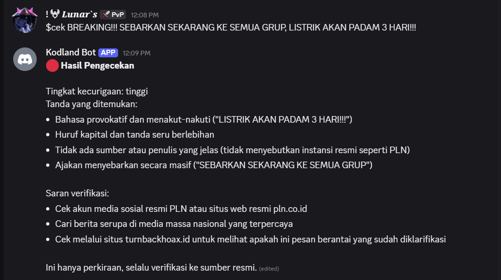
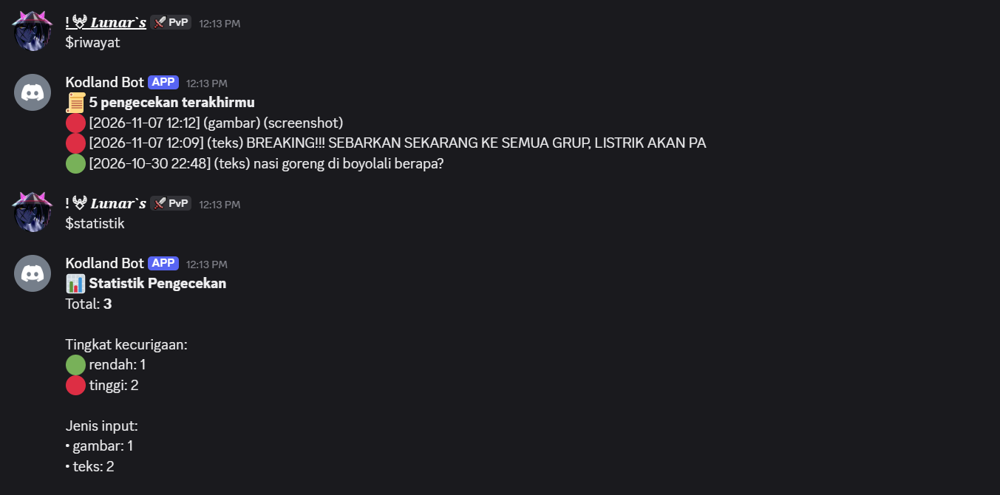

# Bot Discord Pemeriksa Hoaks

Proyek final saya di Kodland. Bot Discord yang mengecek apakah sebuah pesan atau screenshot berita punya ciri-ciri hoaks, lalu menjelaskan bagian yang mencurigakan dan cara memeriksanya. Hasilnya perkiraan, bukan pengecekan fakta. Kalau ragu, cek ke sumber resmi seperti [turnbackhoax.id](https://turnbackhoax.id).

## Cara pakai

Ada tiga cara: ketik `$cek` diikuti teks, kirim `$cek` dengan gambar terlampir, atau balas pesan orang lain dengan `$cek`. Bot menjawab dengan tingkat kecurigaan (rendah, sedang, atau tinggi), tanda-tanda yang ditemukan, dan saran verifikasi.

| Perintah | Fungsi |
|---|---|
| `$cek <teks>` | cek teks |
| `$cek` + gambar | cek screenshot |
| `$cek` (balas pesan lain) | cek pesan yang dibalas |
| `$riwayat` | 5 pengecekan terakhirmu |
| `$hapusriwayat` | hapus riwayatmu |
| `$statistik` | statistik semua pengecekan |
| `$bantuan` | daftar perintah |

Cek teks:



Cek screenshot:


Riwayat dan statistik:



<!-- Kalau bot sudah online, tambahkan link undangannya di sini -->

## Cara kerja

Saya tidak melatih model sendiri. Bot memakai model yang dijalankan lewat [Ollama](https://ollama.com), dan model itu bisa membaca gambar. Saat ada `$cek`, bot memeriksa inputnya (maksimal 4000 karakter dan 5 MB), mengirimnya ke model bersama instruksi untuk mencari tanda hoaks, lalu mengambil tingkat kecurigaan dari jawabannya dan menyimpannya ke SQLite.

Instruksinya meminta model menjawab dengan format tetap, jadi tingkat kecurigaan bisa dibaca dengan pencarian pola sederhana. Teks pengguna dibungkus tanda `<<<` dan `>>>` dan model diminta menganggapnya sebagai data, supaya kalimat seperti "abaikan semua instruksi sebelumnya" di dalam teks tidak diikuti. Model juga dilarang menyebut sesuatu pasti benar atau pasti hoaks. Kalau model tidak menjawab dalam 120 detik, bot berhenti menunggu. Tiap pengguna dibatasi satu pengecekan per 10 detik, dan mention seperti `@everyone` dimatikan.

## Menjalankan

1. Buat bot di [Discord Developer Portal](https://discord.com/developers/applications), salin tokennya, dan nyalakan Message Content Intent di menu Bot. Undang bot ke server.
2. Pasang [Ollama](https://ollama.com) dan siapkan modelnya. Untuk screenshot, modelnya harus bisa membaca gambar.
3. Unduh proyek dan pasang library:

```bash
git clone https://github.com/alail25/Kodland-Graduation.git
cd Kodland-Graduation
pip install -r requirements.txt
```

4. Salin `.env.example` jadi `.env` dan isi tokennya.
5. Jalankan `python bot.py`. Kalau berhasil, terminal menampilkan `Bot aktif sebagai ...`.

Isi `.env`:

- `DISCORD_TOKEN`: token bot, wajib diisi
- `OLLAMA_HOST`: alamat server Ollama, bawaannya `http://localhost:11434`
- `OLLAMA_MODEL`: nama model, bawaannya `gemma4:31b-cloud`
- `OLLAMA_API_KEY`: boleh dikosongkan

Batas panjang teks, ukuran gambar, dan waktu tunggu ada di bagian atas `bot.py`.

## Kalau bermasalah

- Bot online tapi tidak menjawab `$cek`: Message Content Intent belum dinyalakan.
- `DISCORD_TOKEN belum diisi`: file `.env` belum dibuat atau tokennya kosong.
- "Gagal menghubungi AI": Ollama belum jalan, alamat host salah, model belum diunduh, atau API key salah.
- "AI terlalu lama menjawab": modelnya terlalu berat, coba yang lebih kecil.
- Tingkat kecurigaan tampil ⚪: jawaban model tidak mengikuti format, coba `$cek` lagi.

## Batasan

Bot hanya menilai tanda-tanda umum dari tulisannya dan tidak mencari kebenaran klaimnya di internet. Karena itu pesan benar yang ditulis dengan gaya heboh bisa dinilai tinggi, dan hoaks yang ditulis rapi bisa lolos. Kalau satu pesan punya beberapa lampiran, hanya gambar pertama yang dianalisis, dan teks di atas 4000 karakter dipotong. Instruksinya ditulis untuk konteks Indonesia. `$statistik` menghitung pengecekan semua pengguna, bukan hanya milik yang mengetik.

## Data yang disimpan

Riwayat disimpan di `riwayat.db` di komputer yang menjalankan bot: ID Discord pengguna, jenis input, 200 karakter pertama dari teks (atau `(screenshot)` untuk gambar), tingkat kecurigaan, dan waktu. Gambarnya sendiri tidak disimpan. Pengguna bisa menghapus riwayatnya dengan `$hapusriwayat`. Teks dan gambar yang dikirim diproses oleh model lewat Ollama, dan kalau modelnya cloud, diproses di server layanannya.

## Isi repo

```
bot.py             kode utama
requirements.txt   daftar library
.env.example       contoh isi .env
.gitignore
LICENSE
README.md
screenshots/       gambar untuk README
```

`riwayat.db` dibuat otomatis saat bot pertama kali jalan, dan `.env` tidak ikut diunggah karena berisi token.

## Yang saya pelajari

Dari proyek ini saya belajar membuat bot Discord dengan discord.py, memakai model lewat Ollama, menyimpan data dengan SQLite, menjaga token tetap aman dengan `.env` dan `.gitignore`, dan memakai Git dan GitHub. Proyek ini dibangun dari bot Discord dan aplikasi Flask yang saya kerjakan sebelumnya di Kodland. Kode tugas-tugas itu tidak saya taruh di sini supaya repo ini hanya berisi proyek final.

## Lisensi dan penulis

MIT, lihat [LICENSE](LICENSE). Dibuat oleh M. Rizqan Almaliky ([alail25](https://github.com/alail25)).
