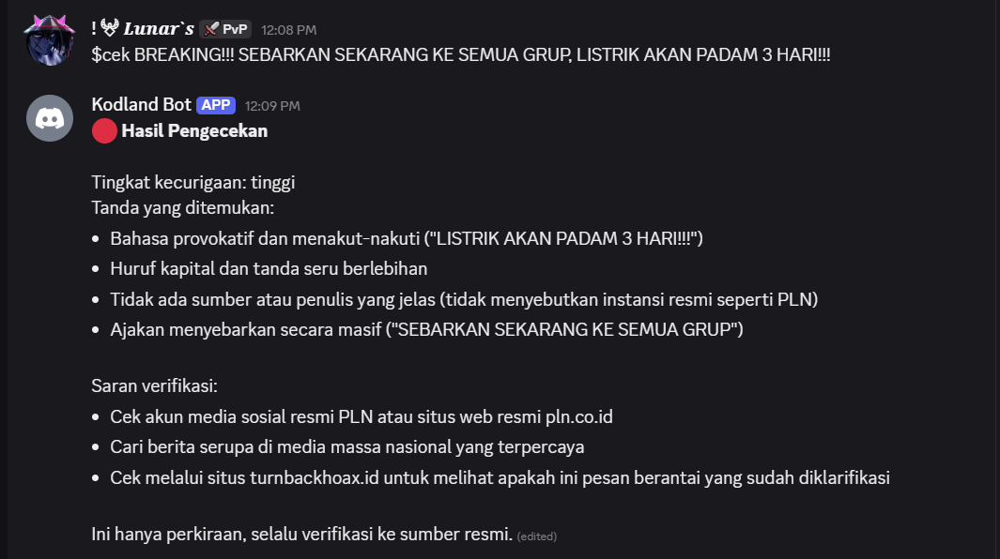
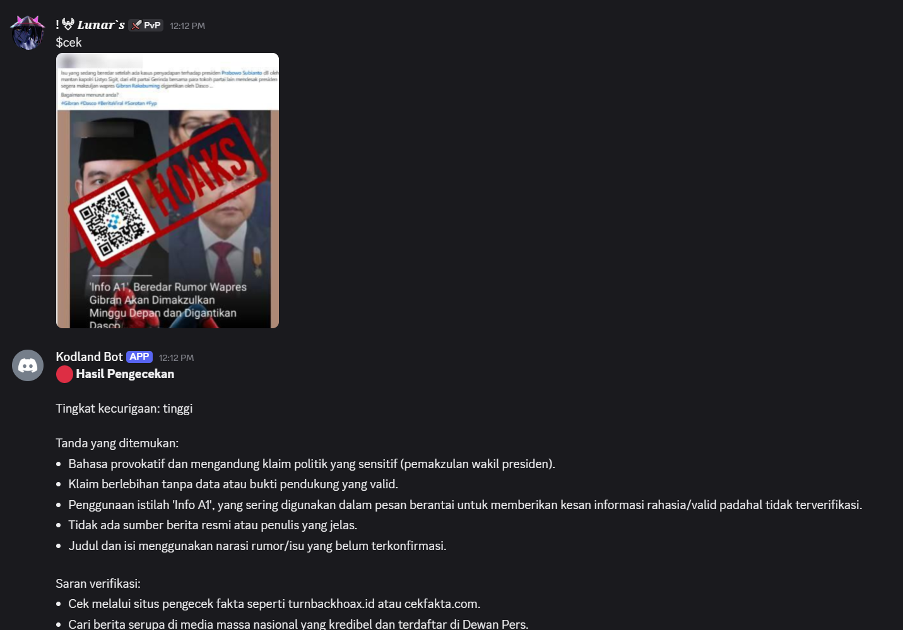
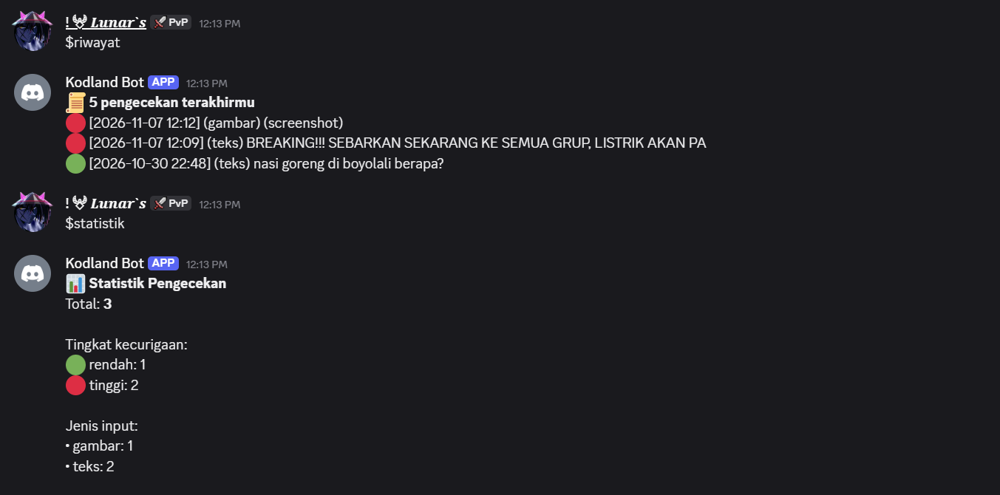

# Bot Discord Pemeriksa Hoaks

Ini proyek final saya di Kodland. Bot Discord untuk mengecek apakah sebuah pesan atau berita punya ciri-ciri hoaks. Kita kirim teksnya atau screenshot-nya, lalu bot kasih tahu bagian mana yang mencurigakan dan bagaimana cara mengeceknya.

Hasilnya cuma perkiraan, bukan pengecekan fakta. Tetap cek ke sumber resmi, misalnya [turnbackhoax.id](https://turnbackhoax.id).

## Deskripsi

Saya sering melihat pesan berantai dan screenshot berita palsu beredar di grup chat. Karena itu saya bikin bot yang bisa dipanggil langsung di Discord, supaya orang bisa cek dulu sebelum ikut menyebarkan.

Cara pakainya ada tiga:

- `$cek` diikuti teks
- `$cek` sambil melampirkan gambar
- balas pesan orang lain dengan `$cek`

Bot lalu menjawab dengan tingkat kecurigaan (🟢 rendah, 🟡 sedang, 🔴 tinggi), tanda-tanda yang ditemukan, dan saran untuk verifikasi. Semua pengecekan disimpan, jadi tiap orang bisa melihat riwayatnya sendiri dan ada statistik keseluruhan.

### Bagaimana bot memakai model AI

Saya tidak melatih model sendiri. Bot memakai model yang dijalankan lewat [Ollama](https://ollama.com), dan model itu bisa membaca gambar.

Waktu ada yang mengetik `$cek`, bot mengirim teks atau gambarnya ke model, bersama instruksi untuk mencari tanda hoaks seperti bahasa yang menakut-nakuti, huruf kapital dan tanda seru berlebihan, tidak ada sumber, klaim tanpa data, dan ajakan "sebarkan ke semua grup". Kalau inputnya screenshot, model membaca tulisan di gambar dulu baru menganalisisnya. Jawaban model punya format tetap, jadi bot bisa mengambil tingkat kecurigaannya lalu menyimpannya ke database SQLite.

Teks dari pengguna saya bungkus dengan tanda `<<<` dan `>>>` dan model diminta menganggapnya sebagai data saja. Tujuannya supaya kalimat seperti "abaikan semua instruksi sebelumnya" di dalam teks tidak diikuti.

## Perintah

| Perintah | Fungsi |
|---|---|
| `$cek <teks>` | cek teks |
| `$cek` + gambar | cek screenshot |
| `$cek` (balas pesan lain) | cek pesan yang dibalas |
| `$riwayat` | 5 pengecekan terakhirmu |
| `$hapusriwayat` | hapus riwayatmu |
| `$statistik` | statistik semua pengecekan |
| `$bantuan` | daftar perintah |

Contoh:

```
$cek BREAKING!!! SEBARKAN SEKARANG KE SEMUA GRUP!!!
```

## Tangkapan layar

Cek teks:



Cek screenshot:



Riwayat dan statistik:



<!-- Kalau bot sudah online, tambahkan link undangannya di sini -->

## Yang dipakai

Python, discord.py, Ollama, SQLite, dan python-dotenv.

## Isi repo

```
bot.py             kode utama
requirements.txt   daftar library
.env.example       contoh isi file .env
.gitignore
LICENSE
README.md
screenshots/       gambar untuk README
```

`riwayat.db` dibuat otomatis waktu bot pertama kali dijalankan.

## Cara menjalankan

1. Buat bot di [Discord Developer Portal](https://discord.com/developers/applications), salin tokennya, dan nyalakan **Message Content Intent** di menu Bot. Setelah itu undang bot ke server.
2. Pasang [Ollama](https://ollama.com) dan siapkan modelnya. Kalau mau pakai screenshot, modelnya harus bisa membaca gambar.
3. Unduh proyek dan pasang library:

```bash
git clone https://github.com/alail25/Kodland-Graduation.git
cd Kodland-Graduation
pip install -r requirements.txt
```

4. Salin `.env.example` jadi `.env` lalu isi:

```env
DISCORD_TOKEN=token_bot_kamu
OLLAMA_HOST=http://localhost:11434
OLLAMA_MODEL=gemma4:31b-cloud
OLLAMA_API_KEY=
```

API key boleh dikosongkan kalau tidak dipakai, dan modelnya bisa diganti.

5. Jalankan:

```bash
python bot.py
```

## Batasan yang saya pasang

- teks maksimal 4000 karakter dan gambar maksimal 5 MB
- cooldown 10 detik per pengguna
- kalau model tidak menjawab dalam 120 detik, bot berhenti menunggu
- `@everyone` dan mention lainnya dimatikan supaya bot tidak bisa dipakai untuk spam
- riwayat hanya menyimpan 200 karakter pertama dari teks
- token ada di `.env` dan tidak ikut diunggah ke GitHub

## Yang saya pelajari

Dari proyek ini dan tugas-tugas sebelumnya, saya belajar membuat bot Discord dengan discord.py, memakai model AI lewat Ollama, menyimpan data dengan SQLite, menjaga token tetap aman dengan `.env` dan `.gitignore`, dan memakai Git serta GitHub. Sebelum proyek final saya juga mengerjakan bot Discord, aplikasi Flask, model Keras, Ollama, dan speech recognition. Kodenya tidak saya taruh di sini supaya repo ini hanya berisi proyek final.

## Lisensi

MIT. Detailnya ada di file [LICENSE](LICENSE).

## Penulis

M.Rizqan Almaliky (alail25), lulusan Kodland. [github.com/alail25](https://github.com/alail25)
